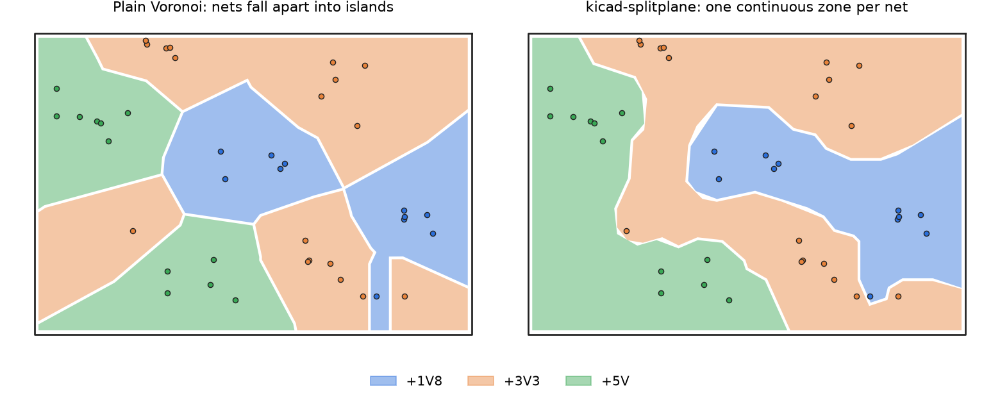

# kicad-splitplane

Split a KiCad power layer into **exactly one continuous copper zone per voltage**, computed from where your vias are.

**[Documentation →](https://people.ee.ethz.ch/~atuzlak/kicad-splitplane/)**



On a 4-layer board the inner power layer is often shared by several supplies (5V, 3.3V, 1.8V…). Each supply needs its own zone, and each zone has to

- contain every via and through-hole pad of its net,
- contain nothing of the other nets,
- be **one continuous surface**.

Drawing those outlines by hand is trial and error. kicad-splitplane does it for you and writes the zones straight into a copy of your `.kicad_pcb`.

## Quick start

```bash
git clone https://github.com/atuzlak/kicad-splitplane
cd kicad-splitplane
pip install -r requirements.txt        # shapely>=2.0, numpy, scipy, matplotlib

python kicad_splitplane.py examples/demo_board.kicad_pcb --nets +5V +3V3 +1V8
```

On your own board:

```bash
python kicad_splitplane.py board.kicad_pcb --list-nets                      # find the supply nets
python kicad_splitplane.py board.kicad_pcb --layer In2.Cu --nets 5V 3.3V VBUS
```

This writes `board_splitplane.kicad_pcb` (your board plus the zones; the original is untouched) and `board_splitplane.png` (preview). Open the new board in KiCad, press **B** to fill the zones and run DRC.

Or install it as a command:

```bash
pip install git+https://github.com/atuzlak/kicad-splitplane
kicad-splitplane board.kicad_pcb --nets 5V 3.3V VBUS
```

## Options

| Option | Default | Meaning |
|---|---|---|
| `--layer` | `In2.Cu` | Copper layer to split |
| `--nets` | | Supply nets that share the layer |
| `--list-nets` | | Print supply-like nets with their via / SMD pad counts |
| `--gap` | 0.5 mm | Copper gap between neighbouring zones |
| `--edge` | 0.5 mm | Clearance to the board edge |
| `--min-neck` | 1.0 mm | Warn where a zone gets narrower than this |
| `--res` | 0.5 mm | Routing grid. If a via gets trapped, try 0.3–0.6 |
| `--include-smd` | off | Treat SMD pads as vias: preview **before** you place the power vias |
| `--plain` | off | Skip connecting the vias (faster, may create islands) |
| `--keep-old` | off | Keep existing zones of these nets on the layer (default: replaced) |
| `--out` | `<board>_splitplane.kicad_pcb` | Output file |

Exit code is `0` when every net got one clean zone, `1` when there are warnings.

## How it works

1. **Seeds.** Read the board (a small S-expression parser, no KiCad needed) and collect every via and through-hole pad of the chosen nets that reaches the layer, plus the outline from Edge.Cuts.
2. **Spines.** For each net, join all its vias with a tree of 45° paths on a grid (Prim's algorithm with Dijkstra). Paths keep clear of other nets' vias and of spines routed before, and prefer the middle of free space (cost ∝ 1/distance to foreign copper). All routing orders of the nets are tried; the one with the fewest trapped vias and the shortest spines wins.
3. **Split.** Every grid cell goes to the nearest spine, i.e. a Voronoi diagram of the spines instead of the vias. A region grown from one connected spine is star-shaped around it, hence connected. The regions are clipped to the outline, shrunk by half the gap and written as KiCad zones.

If a via is completely enclosed by other nets, no continuous split exists. The tool reports it and suggests where to move it:

```
! 5V: via at (87.59, 56.06) is trapped by other nets -> move it to ~(92.60, 65.46) (10.6 mm fanout)
```

## Library use

```python
import kicad_splitplane as sp

text = open("board.kicad_pcb", encoding="utf-8").read()
r = sp.process(text, "In2.Cu", ["5V", "3.3V", "VBUS"], gap=0.5)

print("\n".join(r.log))
open("board_split.kicad_pcb", "w").write(r.board_text)
sp.render_png(r, "preview.png")
```

## Website

`web/` contains the static documentation page. `./deploy.sh --serve` previews it locally, `./deploy.sh user@host:public_html` uploads it.

## Tips and limitations

- Awkward zones usually mean awkward via placement. Keep each net's vias grouped and use short fanout tracks.
- Signals on the neighbouring layer use the split plane as return path; avoid routing them across the gaps.
- Zones are written as outlines without holes. Smaller zones get a higher priority so an enclosed island still fills; check the order in KiCad's Zone Manager.
- Tested with KiCad 10 files; KiCad 7–9 net syntax is supported too. Arcs in the outline are approximated, blind/buried vias are handled roughly.

## Tests

```bash
python -m pytest tests/
```

## Feedback and contact

Found a bug, have an idea for an improvement, or interested in collaborating? Write me an email at [atuzlak@ethz.ch](mailto:atuzlak@ethz.ch). Issues and pull requests are welcome too.

## License

MIT, © 2026 Aleksandar Tuzlak
